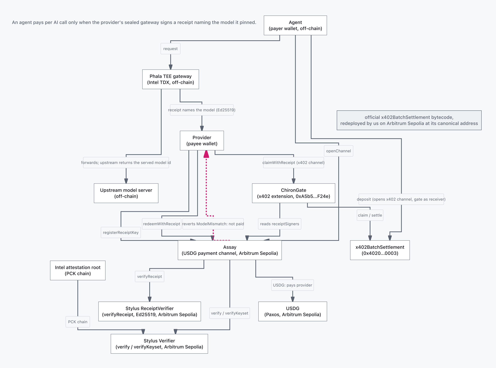

# Chiron

Hosted app: [chiron-receipts.vercel.app](https://chiron-receipts.vercel.app) . Repo: [github.com/pranjalcodesinw3/chiron](https://github.com/pranjalcodesinw3/chiron).

The hosted app opens on the agent account: the deployed `AgentAccount` read live from Robinhood Chain testnet as a gate log (every executed trade with its amount, token and recorded model hash, every proposal and approval, and every refused call with its decoded custom error, each linked to its transaction) beside an agent panel (agent, attested measurement, live key-expiry countdown, model pin), then the owner's mandate (balances, caps, daily window, approval threshold, approved measurements), the two refusals the account issues, and the owner's actions from a connected wallet (create an account, deposit, withdraw, set caps, approve a measurement, approve or reject a pending trade). The Assay pages at `/channel`, `/refusal` and `/verify` read the Paxos USDG Assay on Robinhood Chain testnet by default and switch to the Arbitrum Sepolia Assay from the network bar under the header (`?net=arb`); every view names the chain it reads. On Robinhood Chain, `/refusal` replays a refusal that was mined: the first trade's real Phala receipt, offered to a channel pinned to another model ([`0x9f2bd922...8bdb`](https://explorer.testnet.chain.robinhood.com/tx/0x9f2bd92252dce7827bebac226e269f46956e4d5cc368eb3f6dc7e8253eca8bdb), `ModelMismatch()`).

Named for the one trustworthy centaur: the attested agent among substitutes.

Chiron is attested trading accounts for AI agents on Robinhood Chain. An `AgentAccount` holds USDG and Stock Tokens and swaps only through the canonical Uniswap v4 PoolManager. It accepts a trade from exactly one caller: an agent key that Intel TDX attestation put there, checked onchain by a Stylus contract against a workload measurement the owner approved. Every trade stays inside per-token caps the owner set, trades above the owner's approval threshold wait for the owner, and each trade's event records the agent's workload measurement and the verified inference receipt that preceded it. The agent's inference is billed from the same account through Assay, a pay-per-call USDG channel.

The contracts are `AgentAccount` and `AgentAccountFactory` (`contracts/src/`), the Stylus `Verifier` and `ReceiptVerifier` (`verifier/`, `receipt-verifier/`), and `Assay` (`contracts/src/Assay.sol`).

## Why the account checks the software

Robinhood announced Robinhood Agents at HOOD Summit on 2026-09-29: a dedicated agentic account, trade approvals that default to on, limits the user sets, and Loops "coming soon", for eligible U.S. customers ([Robinhood newsroom](https://robinhood.com/us/en/newsroom/hood-summit-2026/)). The same page states that "Robinhood does not control, supervise, monitor, recommend, or audit agents." Chiron puts the same account shape on Robinhood Chain and moves the audit into the contract: the account trades for a key only after a Stylus verifier has parsed that key's TDX quote chain to Intel's root and the quote's measurement is one the owner approved. Owner caps and approvals are enforced by the account's code, in the same transaction as the swap.

## How it works

**1. The owner configures the account.** `AgentAccountFactory.createAccount(owner)` deploys one account per owner. The owner sets `setLimits(token, {allowed, perTrade, daily, approvalAbove})` for each token, in raw units of the token that leaves the account; `setPool` for each hookless v4 pool the agent may use (both tokens must be allowed first); `setMeasurement` for each agent workload measurement it trusts; and `setModel` to pin the requested model hash, up to four served-model hashes, and the gateway measurement that receipts must come from. A new account can do nothing until it is configured.

**2. The agent key is admitted by attestation.** Anyone can call `registerAgent(quote, refBlock)`. The nonce the quote must commit to is derived by the account:

```
nonce  = keccak256(chainid, account, agentEpoch, arbBlockHash(refBlock))
report_data = agent address (20 bytes) || 12 zero bytes || nonce
```

`arbBlockHash` answers only for the last 256 L2 blocks, so a quote cannot be fetched ahead and banked. The Stylus `Verifier` checks the quote's PCK certificate chain, QE report and quote signature against Intel's root, rejects the TDX DEBUG attribute, and returns the agent address and a measurement over nine TD report fields. The account stores the agent only if that measurement is one the owner approved and the agent is not the owner. Each quote is single use, each registration or revocation bumps `agentEpoch` (which invalidates every quote in flight), and a registration lasts 24 hours. Unapproving the measurement the current agent was admitted under revokes that agent in the same transaction.

**3. The agent trades a typed `Trade`.** `execute(trade, receipt)` takes a pool key, a direction, `amountIn`, `minOut` and a deadline, never calldata. The tokens in and out are derived from the pool key and direction. The account checks, in order: caller is the registered agent, unexpired, not paused; deadline; non-zero amounts; pool and both tokens allowed; `amountIn <= perTrade`; `amountIn <= approvalAbove`; the rolling 24-hour spend for the token in; and the inference receipt. Then the account itself calls `unlock`, `swap`, `settle` and `take` on the PoolManager and takes the output to itself. It never approves a spender for trading, and settlement is by balance delta: `spent <= amountIn` and `received >= minOut`, or the transaction reverts. The 24-hour cap is a rolling window over 25 hourly buckets, so any 24-hour interval is covered by one check.

**4. Trades above the threshold need the owner.** When `amountIn` is above `approvalAbove`, `execute` reverts `NeedsApproval`. The agent calls `propose(trade, receipt)` instead, which stores the trade's hash and the receipt record. The owner's `approveTrade(id, trade)` runs exactly that trade, once, only while the proposal is unexpired (the earlier of the trade deadline and `approvalTtl`), the proposing agent is still the registered agent, the trade still passes the pool, token and per-trade checks, and the account is not paused. The owner can `rejectTrade`, and the agent can `cancelProposal`.

**5. Each trade records its workload.** `TradeExecuted` carries `agentMeasurement` (the TDX workload measurement the agent was admitted under), `servedModelHash`, `requestHash`, `responseHash` and the `proposalId` for approved trades. The receipt behind it is a Phala gateway receipt verified by the Stylus `ReceiptVerifier` (Ed25519 over the receipt's canonical bytes). The account requires the requested model to equal the owner's pin, the served model to be in the owner's accepted set, the receipt key to be registered in Assay under the pinned gateway measurement and unexpired, and the receipt's request and response hashes never to have been used before.

**6. Inference is billed from the account.** `openInferenceChannel(provider, amount)` opens an Assay channel with the account as the channel's agent, pinned to the account's model and gateway measurement. Vouchers the agent key signs are valid for that channel only: the account's ERC-1271 `isValidSignature` accepts an Assay voucher digest for the account's own open channel, signed by the current unexpired agent while the account is not paused, and answers `0xffffffff` for every other digest. The provider is paid through Assay's `redeemWithReceipt`, described below.

**Owner powers.** `pause`, `revokeAgent`, `withdraw`, `withdrawETH`, and every policy setter are owner-only. Ownership transfer is two-step, `renounceOwnership` reverts, and the agent key can never become the owner, so it can never approve its own proposals.

## The venue on Robinhood Chain testnet

Chain 46630. Trades route through the canonical Uniswap v4 PoolManager `0x8366a39CC670B4001A1121B8F6A443A643e40951`, whose runtime code hash is the same on testnet and mainnet (`0xbd38...5626`); the deploy script refuses to run if it differs. The stock side is Robinhood's official TSLA Stock Token `0xC9f9c86933092BbbfFF3CCb4b105A4A94bf3Bd4E`, funded from the official faucet. The quote side is two assets. `TestUSDG`, a 6-decimal fixture the deploy script deploys with open minting, quotes the first pool. Paxos's testnet USDG `0x7E955252E15c84f5768B83c41a71F9eba181802F` (6 decimals) quotes a second hookless 0.3% TSLA/USDG pool the same account is allowed to trade: the account takes any token the owner gives limits and any pool the owner allows, and `contracts/script/rhc/AddUSDGVenue.s.sol` creates the pool and configures the account. `RHCVenue` creates the hookless 0.3% TSLA/testUSDG pool on the PoolManager and funds a full-range position through the PositionManager and Permit2 at a price the script sets (250 testUSDG per TSLA by default).

## Business model

The buyer is a team that runs trading agents with other people's money: a hosted-agent operator (39 agents hosted by Agents Hood on Robinhood Chain, Bankr routing $178.66M of Robinhood Chain volume in 30 days, both in `docs/research/chiron-pivot-verdict.md`). Today their clients hand a key to the operator's backend. With Chiron the operator runs one attested CVM, each client owns an account and sets its own caps, and the operator proves to every client which code holds the key and which model made each trade. The client pays the operator for the agent; the operator pays for one CVM and for keeping each client's admission fresh, which on Robinhood Chain testnet measured 2,429,944 and 2,444,609 gas per `registerAgent` (`0x8737f5cb`, `0xd345d42f`), about 0.0000244 ETH each at the testnet's 0.01 gwei.

The contracts meter two things the account owner pays for.

- **Each trade pays the pool's fee tier.** The owner allows each pool through `setPool`, and the pool key's `fee` is part of what the owner approves (`PoolSet` records it). The pools on this deployment are the 0.3% tier, `fee` 3000 in v4's hundredths of a basis point, which is 30 bps of `amountIn` settled inside the swap.
- **Each inference call is billed per call through Assay.** The account opens a channel as its own agent, the agent key signs a cumulative voucher per call, and the provider is paid the voucher's increase in USDG by `redeemWithReceipt` only against a receipt that names the pinned model. On Arbitrum Sepolia one call was 0.30 USDG.
- **Who earns.** The inference provider keeps every unit the voucher moves: `redeemWithReceipt` sends the whole increase to the channel's provider (`_push(c.provider, delta)` in `contracts/src/Assay.sol`), and Assay takes no protocol fee, so a provider's price is the agent's whole cost. The pool's liquidity providers earn the 30 bps fee tier on each trade. The owner pays both, and only for trades inside the mandate and calls whose receipt names the pinned model.

## Verification

| Check | Result |
|---|---|
| `make test` from a fresh clone (`forge test`, 20 suites) | 296 passed, 0 failed, 1 skipped |
| `AgentAccount` unit, window fuzz and invariant suites | 89 passed |
| `AgentAccount` RHC fork tests against live testnet state (`make test` sets `RHC_FORK_URL=https://rpc.testnet.chain.robinhood.com`) | 4 passed |
| Mutation runner, one guard removed or weakened at a time | 109 of 110 killed, 1 equivalent mutant documented, restored suite green: `docs/security/agent-account-mutations.md` |
| `agent` `npm test` | 27 passed |
| `receipt-verifier` `cargo test`, `verifier` `cargo test` | 18 passed, 22 passed |

The mutation runner (`contracts/test/mutation/agent_account_mutations.py`) builds under its own `mutation` profile with a separate output and cache directory and restores the source on exit. Each mutant removes one guard (the quote replay check, the measurement allowlist, the per-trade cap on each path, the rolling-window arithmetic, the receipt model checks, the reentrancy guards, the ERC-1271 scope, and so on). The unit, window and invariant suites must go red for each, and the restored source must go green.

## Live on Robinhood Chain testnet (chain 46630)

Inference on this account bills through Assay, which is already paid live in real Paxos USDG on Arbitrum Sepolia: three Phala calls, each settled by `redeemWithReceipt` against a verified receipt ([`0x16270367...a55d`](https://sepolia.arbiscan.io/tx/0x16270367e3c3e563bd4433d9cb33d9bdf5db84d44fb25fd0f44679aad681a55d), [`0x4c83cf96...43b7`](https://sepolia.arbiscan.io/tx/0x4c83cf961efedc3678c00d18e332aa502ac71e583ec3f5c42f24a1a5589043b7), [`0x4ed9077a...f868`](https://sepolia.arbiscan.io/tx/0x4ed9077a367495ddfb1acf4a3bbc54bf4b79b0d9898e4614fbe9148ec12cf868)), 0.90 USDG to the provider in total (`channels(2).paid` = 900000, token `0xFFC95faa...1892`).

Deployed 2026-10-01 from `0x2aD12a72362704367e99a344cFf5affDDF7f5DEF`, which owns the account. Every contract below was read back after deployment; `contracts/deployments/46630.json` holds the full record with every transaction hash, and each transaction's `cast receipt` status is success.

| Contract | Address | What it is |
|---|---|---|
| AgentAccount | [`0x9c69A43F16E994Ce45e9EE896E2D01369b0Aaa6D`](https://explorer.testnet.chain.robinhood.com/address/0x9c69A43F16E994Ce45e9EE896E2D01369b0Aaa6D) | The owner's account. Source verified on Blockscout. |
| AgentAccountFactory | [`0xA5b57CA7961A96E75E3Ed1915F5677382d44F24e`](https://explorer.testnet.chain.robinhood.com/address/0xA5b57CA7961A96E75E3Ed1915F5677382d44F24e) | Creates one account per owner. Source verified on Blockscout. |
| Verifier | [`0x3c19C10E5C9a82D01ED79E5c6026D73B9b2CAF8c`](https://explorer.testnet.chain.robinhood.com/address/0x3c19C10E5C9a82D01ED79E5c6026D73B9b2CAF8c) | Stylus (Rust). Verifies an Intel TDX DCAP quote chain, returns the signer and the nine-field measurement. |
| ReceiptVerifier | [`0x9AF7D9C3B27c4A8a11Fb879041B931C38B712380`](https://explorer.testnet.chain.robinhood.com/address/0x9AF7D9C3B27c4A8a11Fb879041B931C38B712380) | Stylus (Rust). Verifies one Ed25519-signed Phala inference receipt. |
| Assay | [`0x2176E7f20654C8747Fa37b3d96E1ACbf7Df55b5D`](https://explorer.testnet.chain.robinhood.com/address/0x2176E7f20654C8747Fa37b3d96E1ACbf7Df55b5D) | The inference payment channel the account bills through. Source verified on Blockscout. |
| TestUSDG | [`0x3500DaF0ADcE615A0bEF108FF0751ABb34b1FfCC`](https://explorer.testnet.chain.robinhood.com/address/0x3500DaF0ADcE615A0bEF108FF0751ABb34b1FfCC) | 6-decimal quote asset for the venue, minted by the deploy script, on Robinhood Chain testnet (46630). Source verified on Blockscout. The Arbitrum Sepolia Assay has the same address because the same deployer created both at nonce 6; they are different contracts on different chains. |
| Assay (Paxos USDG) | [`0xcF4a98E2...3f9d`](https://explorer.testnet.chain.robinhood.com/address/0xcF4a98E21D4180b32B9726ef3d0A550A69973f9d) | The inference channel in Paxos's testnet USDG `0x7E955252E15c84f5768B83c41a71F9eba181802F`, same Stylus verifiers and gateway measurement. Source verified on Blockscout. A payer opens a channel with one EIP-2612 signature and one transaction: [`openChannelWithPermit`](https://explorer.testnet.chain.robinhood.com/tx/0xb8ea952fca22696105f5a0bdf65a416d92cbe52c1615639957e84edb0cb06e47), 1 USDG, USDG permit nonce 0 to 1 (`npm run assay-usdg-permit` in `agent/`). USDG comes from the Paxos faucet, faucet.paxos.com, which lists Robinhood Chain testnet. |
| TSLA Stock Token | [`0xC9f9c86933092BbbfFF3CCb4b105A4A94bf3Bd4E`](https://explorer.testnet.chain.robinhood.com/address/0xC9f9c86933092BbbfFF3CCb4b105A4A94bf3Bd4E) | Robinhood's official testnet Stock Token. |
| Uniswap v4 PoolManager | [`0x8366a39CC670B4001A1121B8F6A443A643e40951`](https://explorer.testnet.chain.robinhood.com/address/0x8366a39CC670B4001A1121B8F6A443A643e40951) | Canonical deployment, code hash equal to mainnet. |

| Step | Transactions | Result read back |
|---|---|---|
| Verifier deploy and activation | [`0xf500c6a6...22d8`](https://explorer.testnet.chain.robinhood.com/tx/0xf500c6a6c5b17dde0d2e96d95f7f4d4873af7a78e71e5413396c1ae73c0d22d8), [`0x51206397...c117`](https://explorer.testnet.chain.robinhood.com/tx/0x51206397c65caa23ceabd5397e7ef3c6cb1ce2b69a25713f6af914b8d7cac117) | Stylus program deployed and activated |
| ReceiptVerifier deploy and activation | [`0xb936516b...5b02`](https://explorer.testnet.chain.robinhood.com/tx/0xb936516b05299ec4bba8f9bbbd38e996b109107289647bf6fd8fd53ff9955b02), [`0x062445c2...2d78`](https://explorer.testnet.chain.robinhood.com/tx/0x062445c238af15976d9ff73201026e5b94b6666fabc13ab3c1f1238001da2d78) | Stylus program deployed and activated |
| Deploy script | 18 transactions, first [`0x5c032428...723a`](https://explorer.testnet.chain.robinhood.com/tx/0x5c0324286ef538a446d3614fc178335b5336c2d8e8131121e9033cf2bd88723a), last [`0x49401a8a...84f7`](https://explorer.testnet.chain.robinhood.com/tx/0x49401a8a560deedc1fb0c9f1945102af3c493b5847d9c24d543ccf2d636f84f7), blocks 127033507 to 127033779 | testUSDG, Assay, pool and liquidity, factory, account, limits, pool allowlist, model pin, funding, inference channel 0 (5 testUSDG deposit) |
| Register Phala's gateway signer on this Assay | [`0x58c5a715...1c05`](https://explorer.testnet.chain.robinhood.com/tx/0x58c5a715f26b95c2dd9fff6a845f48cd3761e7f942a6131bbcd54ece65f11c05) | `signers(0x79a5...6b79)` = measurement `0xfd34...0149` |
| Register Phala's Ed25519 receipt key | [`0x31821e0b...432d`](https://explorer.testnet.chain.robinhood.com/tx/0x31821e0bcf0d9f2083516dfd854adb9366636201d51bc0d34e5ee1566076432d) | `receiptSigners(0x110f...aa0a)` = same measurement |
| Owner deposits 10 testUSDG | [`0x34f3650d...58e5`](https://explorer.testnet.chain.robinhood.com/tx/0x34f3650dff287c1c5fea93364be2fac150069a91a11a45724ed4c6fbe31558e5) | account testUSDG 95,000,000 to 105,000,000 |
| Owner deposits 0.0001 TSLA | [`0xb5c82cf6...ec11`](https://explorer.testnet.chain.robinhood.com/tx/0xb5c82cf607b95d465301a02e899613af4f9731a7bf17a8e6adf5c8ced437ec11) | account TSLA balance up by 1e14 |
| Owner sets the testUSDG approval threshold to 3 then back to 2 | [`0x02e1d9f2...21aa`](https://explorer.testnet.chain.robinhood.com/tx/0x02e1d9f29980035b7519a6a8388e702510443f239fe81ab361056e90035221aa), [`0xf37394f3...5a90`](https://explorer.testnet.chain.robinhood.com/tx/0xf37394f3a1cf3332dfa58377e39111c1508f9bcb7f7bc8c933c0b2b1d6175a90) | `limits(testUSDG)` read back as (true, 10e6, 5e6, 3e6), then (true, 10e6, 5e6, 2e6) |
| Owner sets the approval TTL to 1800 s then back to 3600 s | [`0xecea35b9...4e4c`](https://explorer.testnet.chain.robinhood.com/tx/0xecea35b9914a797c3a906e09d14d411cdbd21e832c1b96db422fa50932f34e4c), [`0x6e39dbc8...4ccd`](https://explorer.testnet.chain.robinhood.com/tx/0x6e39dbc8bde12738d4cbf11e38ed0247a590b9930c2283244b49008bdbdb4ccd) | `approvalTtl()` read back after each |
| Owner withdraws 1 testUSDG | [`0xb825cbf6...69ef`](https://explorer.testnet.chain.robinhood.com/tx/0xb825cbf6683bf01d4f80ed84743556100e866a8b8afe16b3154f561b606369ef) | account 105,000,000 to 104,000,000, owner up by 1,000,000 |

Read from the chain on this deployment:

- The Stylus `Verifier` on 46630 verifies a fresh Phala gateway TDX quote: `verify(quote, nonce)` returns signer `0x79A5061efe5A46b0d1F33B11Cf1c5adbEDAe6B79` and measurement `0xfd34caabef222327146cb5c059810f08bf7c41adb6cc48312be21cc228020149` (2,371,819 gas by `cast estimate`).
- `registerAgent` given a Phala gateway quote bound to the account's own `attestNonce(refBlock)` passes the quote and nonce checks and reverts `MeasurementNotApproved(0xfd34...0149)`, because the owner has not approved that workload. The account admits no agent until the owner approves a measurement and a quote carries it.
- The guards answer on chain: `execute` and `propose` accept only the registered agent (every other caller, the owner included, gets `NotAgent`), `approveTrade` accepts only a pending proposal (`ProposalNotPending`), and `setLimits` keeps the approval threshold at or below the per-trade cap (`BadLimits`).
- Inference channel 0 on Assay lists the account as its agent, the provider wallet `0x93e82363e3481039d2F8Ee3e4b4263B6D141EE5A`, a 5 testUSDG deposit, the gateway measurement above and the channel's model pin `keccak256("phala/qwen3.8-27b-uncensored")`. The account's own receipt pin for trades is `keccak256("meta-llama/llama-3.3-70b-instruct")`, with served model `llama3-3-70b`.

## Agents can check Chiron themselves

`mcp/` is a Model Context Protocol server, built on `@modelcontextprotocol/sdk` 1.31.0, that lets any agent verify a Chiron trade without trusting this page. It is hosted over Streamable HTTP at `https://chiron-receipts.vercel.app/mcp`, so connecting an agent is one line, with nothing to clone or install:

```
claude mcp add --transport http chiron https://chiron-receipts.vercel.app/mcp
```

OpenCode takes the same URL as a remote server in `opencode.json`:

```
{ "mcp": { "chiron": { "type": "remote", "url": "https://chiron-receipts.vercel.app/mcp" } } }
```

Two agent frameworks were driven against the hosted endpoint, each asked to verify the first live trade: Claude Code (Haiku) and OpenCode (`muse-spark-1.3`) both called `verify_receipt` and answered `verified: true` with 7 checks; given a different expected model hash, both answered `verified: false` with `served_model_equals_expected` failing. To run it locally over stdio instead: `cd mcp && npm install && claude mcp add chiron npx tsx $(pwd)/src/server.ts`.

Three tools read Robinhood Chain testnet (46630) directly with viem:

- `verify_receipt(tx_hash)` reads the trade event, recomputes the receipt hash from the receipt bytes in the calldata exactly as `AgentAccount._consumeReceipt` keys it, and checks the recorded served model hash against the account's model pin. It returns `verified` with every check listed, and the answer is false unless every check passes.
- `account_state(account)` returns the agent, measurement, expiry, caps and recent trades.
- `explain_refusal(tx_hash)` decodes a reverted transaction's custom error (`NotAgent`, `ExceedsPerTradeCap`, `MeasurementNotApproved`) into plain words.

`npm test` in `mcp/` checks the real first trade of the live account (`0xe5052266...ddfa2`) and returns `verified: true` with seven passing checks, and a different model hash turns the answer to `verified: false`; `test/http.test.ts` runs the same checks through an MCP client over HTTP, and `MCP_URL=https://chiron-receipts.vercel.app/mcp npm test` points it at the hosted endpoint. The gate log on the hosted app runs the same hashing in the browser and marks each trade green once its recomputed receipt hash matches the chain.

## The attested agent, live

The agent runs inside a Phala Cloud dstack CVM (`agent/src/cvm.ts`, packaged by `agent-cvm/build-image.sh`, deployed from `agent-cvm/docker-compose.yml` with the image pinned by digest). It generates its key in memory, asks the CVM for a TDX quote whose `report_data` is its address plus the account's `attestNonce`, and signs `execute` and `propose` there. The owner key stays on the operator machine: it approves the measurement the Stylus `Verifier` returns for that quote, and approves trades above the threshold.

| Step | Transaction | Result |
|---|---|---|
| Owner approves the first boot's measurement `0x9dfd5de3...b364c8` | [`0x6512a61b...f892e0`](https://explorer.testnet.chain.robinhood.com/tx/0x6512a61b07949d06b349e52bfc63e86ae6599e5105322f4276f5ea8da6f892e0) | `approvedMeasurement` true |
| `registerAgent` with the CVM quote | [`0x1f15df28...a68134`](https://explorer.testnet.chain.robinhood.com/tx/0x1f15df28041e7b8938ca6653eb5a75231f525568ab015644ec535796caa68134) | `agent()` is the CVM key `0x4a0BCAE7...78eA8` |
| In-cap buy, 1.000000 testUSDG | [`0xe5052266...ddfa2`](https://explorer.testnet.chain.robinhood.com/tx/0xe50522661b55c797071b56e43aaf2bc91d37c9745a295ff6a5976883dd4ddfa2) | `TradeExecuted`, 3984027527308004 TSLA out, served model hash `0xc8536dbf...78df59` recorded |
| Over-cap, `perTrade + 1` | [`0xb1adb723...12528c`](https://explorer.testnet.chain.robinhood.com/tx/0xb1adb7231fbd38b77489769d7db754b30f36fa9b1ba97bf14f51980f3b12528c) | reverted `ExceedsPerTradeCap(10000001, 10000000)` |
| Above the threshold, `propose` | [`0x4eb49253...895253`](https://explorer.testnet.chain.robinhood.com/tx/0x4eb4925389368436722b89721dd5db7e28b128923118dfa797e9a7cf42895253) | proposal 1 |
| Owner `approveTrade(1)` | [`0x7f2a63f4...c4d81ead`](https://explorer.testnet.chain.robinhood.com/tx/0x7f2a63f44c439d6099133bad32da8f346414f66f2f8541a3fedca496c4d81ead) | `TradeExecuted`, proposalId 1, 7944291302953708 TSLA out |

**Revoke by measurement.** A CVM boot has its own key and measurement; the demo below ran on the boot whose agent is `0xdd241EC7...A5c7` under `0xeb2d9462...6829`. The account's agent today is `0x00e05262...1579` under `0x0793ff52...31b0`, admitted by [`registerAgent`](https://explorer.testnet.chain.robinhood.com/tx/0x470b7b86b5b55b1fc29c0369acdbc2cdc0bb0bf21d34b5a982e3ffd03867029e) after the owner approved that boot's measurement. The owner withdraws approval of that measurement (`npm run acct-revoke`), and in the same transaction the account de-admits the agent:

| Step | Transaction | Result |
|---|---|---|
| Owner `setMeasurement(0xeb2d...6829, false)` | [`0x0b34701e...8382`](https://explorer.testnet.chain.robinhood.com/tx/0x0b34701eaee5f698b39988a13810e835abee437363093ebc8949ae89bc258382) | `AgentRevoked`, `agent()` is zero |
| The revoked agent's in-cap `execute` | [`0xc0b2e5bc...1e08`](https://explorer.testnet.chain.robinhood.com/tx/0xc0b2e5bc95048ad424a246277a819dfad0238b394ba4bf08cf9dc0231c7e1e08) | reverted, `NotAgent()` by `eth_call`, balances unchanged |
| Owner re-approves, then `registerAgent` with a fresh quote | [`0xc5e5bb9b...7822`](https://explorer.testnet.chain.robinhood.com/tx/0xc5e5bb9bc3e4ca17ace0b52c4352d5ae7cfed1a9a7a8a43b5f7d229fd6447822), [`0x4694b617...9a66`](https://explorer.testnet.chain.robinhood.com/tx/0x4694b617f4bafbd0e3a3f2a09dbe11b5afd0f96fc4023393aaf516ce68f69a66) | re-approval alone leaves `agent()` zero; the fresh quote admits the key again |

**One operator agent, many client accounts.** A hosted-agent operator runs one CVM and serves every client from it. `POST /quote?account=<client>` returns a TDX quote over that client account's own `attestNonce`, so the same attested key is admitted account by account, each owner approving the measurement and setting their own caps. The operator agent `0x71f15e33...3461` (measurement `0x993bd67c...8e9a`, image pinned in `agent-cvm/docker-compose.yml`) is admitted on two accounts from the factory:

| Step | Transaction | Result |
|---|---|---|
| Client account 2 created by `AgentAccountFactory.createAccount` | [`0xbb77ffc9...dae5`](https://explorer.testnet.chain.robinhood.com/tx/0xbb77ffc9a2e5f5cda88e9176a0417758da30c9b8dd8e918dee15cb3d5824dae5) | `0xE1d79391...c34c` |
| Account 1 admits the operator agent | [`0x2889f10b...d196`](https://explorer.testnet.chain.robinhood.com/tx/0x2889f10bf20edff1fa512f52b99d3eb76ac903becdc9410c70a13e11abded196) | `agent()` = `0x71f15e33...3461` |
| Account 2 admits the same agent, with a quote over its own nonce | [`0xdb52757a...f04e`](https://explorer.testnet.chain.robinhood.com/tx/0xdb52757ab39240be57a4aebd3980a57d4bb8c4d8601722e2774f32ab8f87f04e) | `agent()` = `0x71f15e33...3461` |
| Account 2's owner withdraws the measurement | [`0x1d34d37a...8008`](https://explorer.testnet.chain.robinhood.com/tx/0x1d34d37a52a7e099a9741ffa2ff04fbd0e09e9dabefb5731a0f93cee635b8008) | at that block account 2's `agent()` is zero and account 1's is still `0x71f15e33...3461` |
| The keeper renews both accounts from one CVM | [`0x20209f03...5555`](https://explorer.testnet.chain.robinhood.com/tx/0x20209f03a0232b7db7406b69ab68c265340e0d316688ad71aea29089768f5555), [`0xb6e4dc44...aa4e`](https://explorer.testnet.chain.robinhood.com/tx/0xb6e4dc44288956d22d443ff137326932b1093e484a7e6bc8bc57f59dbc90aa4e) | both `agentExpiry()` moved forward |

**Real USDG on both legs.** A second factory, [`0xB9F7eB23...73c3`](https://explorer.testnet.chain.robinhood.com/address/0xB9F7eB234C2F562475668c1Dc9b6850f235373c3), builds accounts bound to Paxos USDG and to the Paxos USDG Assay, and the hosted app's "Create an account" uses it. Account [`0x06AAadCc...2506`](https://explorer.testnet.chain.robinhood.com/address/0x06AAadCc83873775D8A72F42B912f57ab3dc2506) from it trades the TSLA/USDG pool under USDG and TSLA caps, pins `phala/qwen3.8-27b-uncensored` (the model whose receipt label equals its request, so Assay can pay it), admits the same operator agent ([`0xd345d42f...c53d`](https://explorer.testnet.chain.robinhood.com/tx/0xd345d42f33bd3b01319d8b89851c3822fb3ea730482dcd7f0090419d9b16c53d)), and funds its own inference channel in Paxos USDG: [`openInferenceChannel`](https://explorer.testnet.chain.robinhood.com/tx/0xed6e42b7840a47e76e548980b8e62026b3e75c6622443069bdf055a3829a1d32), channel 1 on Assay `0xcF4a...3f9d`, 1 USDG, agent = the account.

A client admits the operator from the hosted app: open the account, step 4 "Admit an operator's agent" reads the CVM's quote for that account, asks the account's Stylus Verifier which key and measurement it proves, and offers "Approve this measurement" to the owner and "Admit the agent" to any wallet.

**Refusals anyone can replay.** Two attacks were sent as real transactions, mined, and refused by the contracts:

| Attack | Transaction | Result |
|---|---|---|
| Stolen signer: a genuine Intel TDX quote from a different workload (Phala's inference gateway, asked to sign this account's `attestNonce`) submitted to `registerAgent` | [`0xf98156ad...fcc8`](https://explorer.testnet.chain.robinhood.com/tx/0xf98156ad950c82abe4ce3ab0eac3da0ae860d1abd91fdb9eb545aa87e7e2fcc8) | reverted `MeasurementNotApproved(0xfd34caab...0149)` after the Stylus `Verifier` checked the full quote (2,348,030 gas); `agent()` unchanged. The hardware is real, the code is not the approved image, so the key is refused |
| Wrong model: the real Phala-signed receipt from the first trade (served `llama3-3-70b`) presented to `Assay.redeemWithReceipt` on a channel pinned to `phala/qwen3.8-27b-uncensored` ([open](https://explorer.testnet.chain.robinhood.com/tx/0x7770a689e6c7445d43b64cbcabb665e4924b62412562bf6b9274fed61818a9f2)) | [`0xfe0f13f0...8eab`](https://explorer.testnet.chain.robinhood.com/tx/0xfe0f13f09e8dc00f99ad8d94024352a127f21150a9340497d3288aec96818eab) | reverted `ModelMismatch()` (`0xa407e5f7`), channel paid 0. The signature is valid and the key is registered; the model is wrong, so nothing is paid |

`npm run assay-model-swap` in `agent/` replays the second one end to end. The gate log on the hosted app lists the first among the account's refusals.

**Real USDG.** The same account trades Paxos's testnet USDG against TSLA. The attested agent bought TSLA with 1 USDG in the second pool: [`0x0023f359...3b03`](https://explorer.testnet.chain.robinhood.com/tx/0x0023f35941a1490017d220c94b41124f53b044b7416f59ea278208ee500e3b03), `TradeExecuted` tradeId 3, 3910026278631909 TSLA out, account USDG 5.000000 to 4.000000. About 55 USDG is in play: the pool position and the account's deposit.

Full record with measurements, compose hash, receipts and read-backs: `docs/e2e/robinhood-testnet-agent-account.md` and `contracts/deployments/46630.json`.


## Deploy and live cycle

`contracts/script/rhc/deploy-stylus.sh` deploys the unchanged `verifier/` and `receipt-verifier/` crates to RHC testnet and reads each back: code exists, and `Verifier.verify` on a stored Phala quote under a nonce it does not carry reverts. `contracts/script/rhc/DeployAgentAccountRHC.s.sol` then deploys testUSDG, Assay, the pool and its liquidity, the factory and one account, configures the owner's limits, pool and model pin, funds the account, opens the inference channel, and reverts the script on any mismatch when it reads back the wiring, pool state, policy, limits and balances. It writes `contracts/deployments/46630.json`.

The agent client runs five live-cycle modes against the deployed account (`acct-register` is the owner side of admission: it fetches the CVM quote, reads the measurement the Verifier returns, approves it and submits `registerAgent`) (keys are read by variable name and never printed):

```
cd agent
ACCOUNT_ADDRESS=0x... npm run acct-register  # CVM quote, Verifier eth_call, approve measurement, registerAgent
ACCOUNT_ADDRESS=0x... npm run acct-trade     # in-policy buy with a real Phala receipt
ACCOUNT_ADDRESS=0x... npm run acct-overcap   # amountIn = perTrade + 1
ACCOUNT_ADDRESS=0x... npm run acct-approve   # band-2 trade: NeedsApproval, propose, approveTrade
ACCOUNT_ADDRESS=0x... npm run acct-revoke    # owner unapproves the measurement, the agent's trade reverts NotAgent, owner re-admits
```

Each mode asserts a post-condition only completion can produce. `acct-trade` decodes the `TradeExecuted` log and checks the account's token balance deltas against `amountOut` and the spent amount, and that the logged `servedModelHash` equals the pinned hash. `acct-overcap` confirms `ExceedsPerTradeCap` by `eth_call`, sends one real reverted transaction, and checks that balances did not move. `acct-approve` confirms `NeedsApproval`, the proposal event, the owner's approval emitting `TradeExecuted` with the proposal id and a balance delta, and a second `approveTrade` reverting `ProposalNotPending`. `acct-revoke` confirms one `AgentRevoked` and a zero `agent()` at the unapproval's block, `NotAgent` by `eth_call` and a reverted transaction with balances unchanged, and that re-approval alone leaves `agent()` zero before a fresh quote admits the key again. `QUOTE_TOKEN=<token>` points `acct-trade` and `acct-revoke` at another allowed quote asset such as Paxos USDG.

## Inference billing: Assay, live on Arbitrum Sepolia

Assay is a USDG payment channel on Arbitrum for AI agents that buy inference per call. The agent's money moves only against proof checked onchain: a Stylus contract verifies the provider gateway's Intel TDX attestation, and a second Stylus contract verifies the gateway's signed receipt for each response. A channel pinned to a model pays only when the receipt says that model was served. If the gateway routed the call to a different model, the payment reverts.

The contract is `Assay` (`contracts/src/Assay.sol`); an `AgentAccount` is one of its channel agents.

**Paid live on Arbitrum Sepolia.** Three real inference calls through Phala's gateway, each paid by `redeemWithReceipt` only after the Stylus verifier accepted the gateway's receipt naming the pinned model: [`0x16270367...a55d`](https://sepolia.arbiscan.io/tx/0x16270367e3c3e563bd4433d9cb33d9bdf5db84d44fb25fd0f44679aad681a55d), [`0x4c83cf96...43b7`](https://sepolia.arbiscan.io/tx/0x4c83cf961efedc3678c00d18e332aa502ac71e583ec3f5c42f24a1a5589043b7), [`0x4ed9077a...f868`](https://sepolia.arbiscan.io/tx/0x4ed9077a367495ddfb1acf4a3bbc54bf4b79b0d9898e4614fbe9148ec12cf868). Channel 2 paid 0.90 USDG to the provider, read back as `channels(2).paid` = 900000.

## What the receipt proves

A TEE running the allowlisted image measurement signed a receipt naming the model it served and hashes of the exact request and response bytes, so a swapped model or an unattested gateway never gets paid. Chiron makes model substitution unprofitable. The channel's check is bound to the redeemed call: the highest voucher wins per channel, and the receipt behind that voucher is verified onchain, while the agent's own local check (see "What the agent does before it signs anything") covers each earlier call in a session.

Attestations are valid 24 hours by design (`attestationValidity` is immutable at 86400 seconds). The provider re-registers its keys daily; see "Keeping keys fresh" below.

## Live on Arbitrum Sepolia

Chain 421614, deployed 2026-09-28 from `0x2aD12a72362704367e99a344cFf5affDDF7f5DEF`. Every address below was read back with `cast call` after deployment; `contracts/deployments/421614.json` holds the full record.

| Contract | Address | What it is |
|---|---|---|
| Assay | [`0x3500DaF0ADcE615A0bEF108FF0751ABb34b1FfCC`](https://sepolia.arbiscan.io/address/0x3500DaF0ADcE615A0bEF108FF0751ABb34b1FfCC) | The payment channel, on Arbitrum Sepolia (421614). Source verified on Sourcify (exact match, creation and runtime). The same address on Robinhood Chain testnet is TestUSDG (same deployer, nonce 6). |
| Verifier | [`0x3c19c10e5c9a82d01ed79e5c6026d73b9b2caf8c`](https://sepolia.arbiscan.io/address/0x3c19c10e5c9a82d01ed79e5c6026d73b9b2caf8c) | Stylus (Rust). Verifies an Intel TDX DCAP quote chain and returns the gateway's signer and image measurement. |
| ReceiptVerifier | [`0x9af7d9c3b27c4a8a11fb879041b931c38b712380`](https://sepolia.arbiscan.io/address/0x9af7d9c3b27c4a8a11fb879041b931c38b712380) | Stylus (Rust). Verifies one Ed25519-signed Phala inference receipt and returns the requested model, served model, request hash and response hash. |
| USDG | [`0xFFC95faa3d63Cde504a05B567C600B78C0b41892`](https://sepolia.arbiscan.io/address/0xFFC95faa3d63Cde504a05B567C600B78C0b41892) | Paxos Global Dollar on Arbitrum Sepolia, Assay's settlement token. |

Assay is source verified (Sourcify, exact match). `Verifier` and `ReceiptVerifier` are Stylus contracts, built reproducibly with `cargo-stylus 0.10.9`, `rustc 1.91.0` and target `wasm32-unknown-unknown`, pinned in each crate's `rust-toolchain.toml`.

Live transactions on this deployment:

| Step | Transaction | Result read back |
|---|---|---|
| Register Phala's gateway signer from a fresh TDX quote bound to Assay's own nonce | [`0xaf4218b9...0d59`](https://sepolia.arbiscan.io/tx/0xaf4218b965aea5b0086a45f12680920411935548698bbebfbe2f085b3bb80d59), block 313675089 | `signers(0x79A5...6B79)` = measurement `0xfd34...0149` |
| Register Phala's Ed25519 receipt key from a second fresh quote | [`0xdff86c7c...ef1f`](https://sepolia.arbiscan.io/tx/0xdff86c7c326ffa23738ec12fc9e7a7c3c930453298c28d7ce26322888a13ef1f), block 313675112 | `receiptSigners(0x110f...aa0a)` = same measurement |
| Open channel 0, pinned to `meta-llama/llama-3.3-70b-instruct` | [`0x61fffc01...bd2`](https://sepolia.arbiscan.io/tx/0x61fffc011aeee16cce4a8075f606bb58d6b05038a7b8d6921460a26db5cacbd2), block 313676162 | deposit 2.000000 USDG |
| Open channel 1, legacy signature path | [`0xb06dae37...2652`](https://sepolia.arbiscan.io/tx/0xb06dae3711bce5b151ea7fb6af0b30a94d37186cd00bb4b06cd7e9460bfd2652), block 313676207 | deposit 2.000000 USDG |
| Open channel 2, pinned to `phala/qwen3.8-27b-uncensored` | [`0x3ebe01a4...a019`](https://sepolia.arbiscan.io/tx/0x3ebe01a4c23a3359599d6ba4c13653b1c5f71649247b02bd7209fe891008a019), block 313984561 | deposit 2.000000 USDG |
| Paid call 1: `redeemWithReceipt` against a real Phala receipt | [`0x16270367...a55d`](https://sepolia.arbiscan.io/tx/0x16270367e3c3e563bd4433d9cb33d9bdf5db84d44fb25fd0f44679aad681a55d), block 313984768 | paid 0.30 USDG |
| Paid call 2 | [`0x4c83cf96...43b7`](https://sepolia.arbiscan.io/tx/0x4c83cf961efedc3678c00d18e332aa502ac71e583ec3f5c42f24a1a5589043b7), block 313984791 | paid 0.60 USDG cumulative |
| Paid call 3 | [`0x4ed9077a...f868`](https://sepolia.arbiscan.io/tx/0x4ed9077a367495ddfb1acf4a3bbc54bf4b79b0d9898e4614fbe9148ec12cf868), block 313984814 | `channels(2).paid` = 900000; provider USDG 0 to 900000 |

Each paid call was a real completion from Phala's gateway (via RedPill), whose receipt named `phala/qwen3.8-27b-uncensored` as both requested and served, with `upstream.verified` = `verified`. The agent checked the receipt locally, signed the voucher, and the provider wallet redeemed it.

The agent wallet (`0x2aD1...5DEF`) pays and the provider wallet (`0x93e8...EE5A`) is paid; the two are different addresses. `docs/e2e/chiron.md` lists every command and post-condition.

## x402 extension: receipt-gated claims on x402's own payment channel

x402's batch-settlement contract lets a buyer stream cumulative vouchers to a seller, but a claim needs no evidence of what was served. `ChironGate` (`contracts/src/ChironGate.sol`) adds that condition without changing x402: the buyer opens a normal x402 channel whose `receiver` and `receiverAuthorizer` are the gate, so the seller can only be paid through `ChironGate.claimWithReceipt`, which requires the buyer's signature over the exact request and response, a Phala receipt whose requested model is the pinned one and whose served model is in the buyer's accepted set, and a receipt key registered in Assay under the pinned measurement. The pins are committed in the x402 channel's own `salt`. Proposed extension fields: `docs/x402-extension.md`.

| Contract | Address |
|---|---|
| ChironGate | [`0xA5b57CA7961A96E75E3Ed1915F5677382d44F24e`](https://sepolia.arbiscan.io/address/0xA5b57CA7961A96E75E3Ed1915F5677382d44F24e) (Sourcify exact match) |
| x402BatchSettlement | [`0x4020074e9dF2ce1deE5A9C1b5c3f541D02a10003`](https://sepolia.arbiscan.io/address/0x4020074e9dF2ce1deE5A9C1b5c3f541D02a10003): the official x402 bytecode, redeployed by us on Arbitrum Sepolia at its canonical CREATE2 address. Same init code as the Arbitrum One deployment; the runtime differs only in the two EIP-712 values bound to the chain id. |
| ERC3009DepositCollector | [`0x4020806089470a89826cB9fB1f4059150b550004`](https://sepolia.arbiscan.io/address/0x4020806089470a89826cB9fB1f4059150b550004): the official x402 bytecode, redeployed by us at its canonical address; runtime identical to Arbitrum One. |

Live through the gate: the agent deposited 1 USDG into an x402 channel with the gate as receiver ([`0x2e35e165...d347`](https://sepolia.arbiscan.io/tx/0x2e35e16523145ae25f7525321c6ccce71dc005facbb0fbe7806e67c31d89d347)), and the provider claimed 0.30 USDG against a real Phala receipt through `claimWithReceipt` ([`0xbfbd454e...82eb`](https://sepolia.arbiscan.io/tx/0xbfbd454e9dff5623677d26b29e402f0390aa1bd53160b0ffa88cb803f60a82eb), 347,363 gas, `ClaimedWithReceipt` emitted). The same claim with a receipt naming another model reverts `ModelMismatch` (`npm run gate-refuse`, an eth_call). A channel can accept up to four served labels because upstreams label models differently: RedPill routes `meta-llama/llama-3.3-70b-instruct` to an upstream whose receipt says `llama3-3-70b`.

The gate went through an independent review (one High found and fixed: the replay record is keyed per channel, so a buyer cannot burn a receipt on a throwaway channel) and a second review of the label set; both ended DEPLOY (`docs/SECURITY.md`). 26 of 26, then 31 of 31, guards fail the tests when removed.

## Keeping keys fresh

`attestationValidity` is immutable at 86400 seconds (24 hours), so a registered signer expires on a fixed clock. A `launchd` job (`com.chiron.keeper.register`, outside `~/Desktop` because launchd cannot read files under `~/Desktop`) re-runs `agent-cvm/register-keys.sh` every 20 hours, which registers the gateway signer and receipt key on all three Assays (Arbitrum Sepolia, and the testUSDG and Paxos USDG Assays on Robinhood Chain testnet), so a judge opening the app days after submission still sees unexpired keys on every chain. Kill it after judging with `launchctl unload ~/Library/LaunchAgents/com.chiron.keeper.register.plist`.

The account's agent runs on the same 24-hour clock (`ATTESTATION_VALIDITY`). `agent-cvm/keeper.sh` checks `agentExpiry()` every 30 minutes (`com.kamal.arbitrium.chiron-keeper`); inside three hours of expiry it asks the CVM for a fresh quote and submits `registerAgent`, then requires receipt status 1 and an `agentExpiry()` later than before. The agent panel on the hosted app turns amber when re-admission is due within two hours and red once the key has lapsed.

## Arbitrum technology

Both verifiers are Stylus contracts (Rust compiled to WASM). The TDX `Verifier` parses a DCAP quote, walks the PCK certificate chain to Intel's root and checks its P-256 ECDSA signatures: 2,304,195 gas on a fresh Phala quote (`cast estimate`, block 313704492). Arbitrum does have a P-256 verification precompile (RIP-7212); the certificate and quote parsing around those signature checks is the bulk of the work, and Stylus runs all of it in one call. The `ReceiptVerifier` checks an Ed25519 signature, which has no EVM precompile, over the receipt's canonical JSON bytes and extracts four fields from it: 174,862 gas as a standalone call on a 676-byte receipt. Both run inside the same transaction that pays, so the check and the payment are atomic.

## The problem

An agent paying per call for an open-weight model cannot see which model answered. A gateway can route the request to a cheaper model, a smaller quantization, or a server nobody attested, and bill for the model that was asked for. Cai, Shi, Zhao and Song ([arXiv 2504.04715](https://arxiv.org/abs/2504.04715)) find that detecting this from outputs alone is unreliable: output-statistics tests miss subtle substitutions, and log-probability checks break on ordinary inference nondeterminism. They propose trusted execution environments as the practical fix.

Phala's confidential gateway (also sold as RedPill) is that fix at the gateway: it verifies the upstream before forwarding, and "if the gateway cannot verify the upstream or enforce the binding on the actual connection, it does not send your prompt" ([verified upstreams](https://docs.redpill.ai/confidential-ai/verified-upstreams.md)). Every response gets a receipt, signed with a key from the gateway's attestation, whose `upstream.verified` event names the model that served it, quantization included when the id carries it, for example `Qwen/Qwen3.6-35B-A3B-FP8` ([receipts](https://docs.redpill.ai/confidential-ai/receipts.md)).

What was missing is a payment that depends on that receipt. A client library can check it, but only after the call was billed. Chiron makes the check and the payment the same transaction, so the case it catches is exact: a response whose signed receipt names a different model id than the one the channel was opened for, or a receipt from a gateway whose attestation is not registered, never gets paid.

A receipt names the model, and pinning the full id, quantization suffix included, makes a silent quantization swap an id mismatch.

## How Assay works



One paid call step by step: [workflow](docs/diagrams/workflow.png). The refusal path in contract order: [refusal sequence](docs/diagrams/refusal-sequence.png).


**1. Register the gateway's keys.** Anyone can call `register(quote, refBlock)`. Assay issues the nonce the quote must commit to:

```
nonce = keccak256(chainid, assay, caller, registerNonce[caller], arbBlockHash(refBlock))
```

The block hash comes from Arbitrum's ArbSys precompile, which answers only for the last 256 L2 blocks (about 66 seconds on Arbitrum Sepolia), so a quote cannot be fetched ahead of time and banked. `Verifier.verify(quote, nonce)` checks the quote's PCK certificate chain, QE report and quote signature (all P-256) against Intel's root, the certificate validity dates against `block.timestamp`, rejects the TDX DEBUG attribute, and requires `report_data` to carry the nonce. It returns the gateway's signing address and a measurement over nine TD report fields (`mr_seam`, `td_attributes`, `xfam`, `MRTD`, `mr_config_id`, `RTMR0` to `RTMR3`). Assay stores the signer only if that measurement is on the allowlist fixed at construction.

`registerReceiptKey(quote, keysetBytes, refBlock, pubkey)` does the same for the Ed25519 key that signs receipts. Phala's ACI attestation does not sign that key directly: its `report_data` commits to `sha256` of a statement containing the digest of the whole workload keyset. `Verifier.verifyKeyset` recomputes that statement from the supplied keyset bytes and the nonce, requires it to equal `report_data[0..32]`, and only then reads the key out of the keyset's `receipt_signing_keys`.

`cd agent && npm run register` does both inside one ArbSys window and checks the stored result afterwards.

**2. Open a channel.** The agent deposits USDG (`openChannel` after `approve`, or `openChannelWithPermit` in one transaction) and pins two things: the image measurement it trusts and, optionally, a model id hash. The deposit is the most the provider can ever take.

- A channel pinned to a model is **receipt-only**. `redeem()` on it reverts `ModelMismatch`, because the legacy signature carries no model evidence.
- A channel with a zero model hash is **legacy-only**, paid against Phala's per-response ECDSA signature.

**3. Pay per call.** For every call the agent signs an EIP-712 voucher over `(channelId, cumulativeAmount, requestHash, responseHash)`. The provider redeems the highest voucher and Assay pays only the difference from what it already paid.

`redeemWithReceipt` pays only if all of these hold:

- the voucher is signed by the channel's agent (its own ECDSA key, or ERC-1271 if the agent is a contract);
- `ReceiptVerifier.verifyReceipt` accepts the Ed25519 signature over the receipt's exact JCS bytes;
- the receipt's **served** model hash and requested model hash both equal the channel's pinned model;
- the receipt's `request.received` and `response.returned` body hashes equal the voucher's `requestHash` and `responseHash`;
- the receipt key is registered, unexpired, and registered under the measurement this channel pinned.

The served model is read from bytes the gateway's TEE signed, not from anything the provider submits separately. A gateway that routed the call to another model produces a receipt that can never pay this channel.

**4. Close.** The agent calls `requestClose` once the channel has been idle for `channelTimeout` (1 hour here). The provider can still redeem during the `challengeWindow` (1 hour), and `finalizeClose` then refunds the rest to the agent. No owner, no upgrade path, no pause, no admin setter.

## What the agent does before it signs anything

`npm run pay-receipt` requests a completion with a fresh nonce in the body, fetches the signed receipt, and checks it locally before creating a voucher. It canonicalizes the receipt itself (RFC 8785), verifies the Ed25519 signature against the key from a fresh attestation, and compares both body hashes with the exact bytes it sent and received. If the served model differs from the requested one, it prints `REFUSING TO PAY` and exits without signing. The onchain check is the guarantee; the local check means an honest agent never spends gas on a call it already knows is bad.

## What the attestation proves

It proves the gateway's key lives in a TDX guest whose nine-field measurement is on Assay's allowlist, under a certificate chain that ends at Intel's root and was valid at the block that checked it. RTMR3 carries the hash of the deployed compose file, so a changed serving image shows up as a changed measurement.

The receipt is the gateway's signed statement, made inside the TEE, of which model the upstream served for this one request and response. Phala records that in the receipt's `upstream.verified` event from the live response. The measurement does not say which weights a model provider loaded behind that; the receipt carries the upstream's own model label.

Assay checks the certificate chain and its validity dates against `block.timestamp`, the DEBUG attribute, and the measurement allowlist. The allowlist carries a single measurement so that the trust decision is made once, by whoever deploys, rather than inferred per quote.

## Security

Four review rounds; the outcome and the regression test for every finding are in `docs/SECURITY.md`. The last two ran against the code deployed here, and each finding came with a test that failed on the unfixed code:

| Finding | Fix |
|---|---|
| A model-pinned channel could still be paid through the legacy path | A pinned channel is receipt-only; `redeem()` reverts `ModelMismatch` |
| An out-of-window `refBlock` produced a zero hash, so the register nonce became a constant a quote could be stockpiled for | ArbSys revert or a zero hash reverts `StaleRefBlock` |
| One receipt could back payments for different requests | The receipt verifier returns `request.received`'s hash and Assay requires it to equal the voucher's |
| An agent whose EIP-7702 delegation changed after signing could void its vouchers | The agent's own ECDSA signature is always accepted; ERC-1271 is asked only if that fails |
| The receipt verifier accepted a forged signature under a small-order public key | `verify_strict` |

Each fix was checked by reverting it and confirming its test goes red, then restoring it. The final review's verdict before redeploy was DEPLOY.

Assay holds real Paxos USDG, whose issuer can pause, freeze and wipe. The fork suite runs against the real USDG proxy and pins what that means: a pause that outlasts the challenge window lets the agent close first, and a frozen agent's refund waits in Assay until Paxos unfreezes (`test_demo_M1_unfreezeRestoresRefund` shows the full refund arriving afterwards). No `refundTo` escape was added, since it would let a frozen party route around the freeze.

Tests on the deployed code: the Assay unit, attack, fuzz, hardening, re-review and invariant suites run inside `make test` (296 passed, 0 failed, 1 skipped; see Verification). The skipped suite is the real-USDG fork suite, which runs when `CHIRON_FUNDED_TEST_ACCOUNT` names a funded Arbitrum Sepolia USDG holder.

## Gas

| Call | Gas | Source |
|---|---|---|
| `Verifier.verify` on a fresh Phala quote | 2,304,195 | `cast estimate`, block 313704492 |
| `register` (verify + store) | 2,346,274 | tx `0xaf4218b9...0d59` |
| `registerReceiptKey` (verify keyset + store) | 2,368,996 | tx `0xdff86c7c...ef1f` |
| `openChannel` | 243,470 | tx `0x61fffc01...bd2` |
| `ReceiptVerifier.verifyReceipt`, one 676-byte receipt | 174,862 | `cast estimate` on the live Stylus contract, block 313924043; a standalone call, so it includes the 21,000 base cost and calldata |
| `redeemWithReceipt`, first redeem on a channel | 301,058 | tx `0x16270367...a55d` |
| `redeemWithReceipt`, later redeems | 285,057 and 284,888 | txs `0x4c83cf96...43b7`, `0x4ed9077a...f868` |

Registration runs once per key rotation. The per-call path is `redeemWithReceipt`, about 285,000 gas once a channel has been paid once. Because the voucher is cumulative, a provider can redeem once for many calls, so this cost is per redeem, not per call.

## Run it

```
make test                        # pinned libs, every Foundry profile, then the whole forge suite
cd receipt-verifier && cargo test
cd verifier && cargo test
cd agent && npm test
```

Against the live deployment (keys in `.env`, loaded by the scripts, never printed): `PRIVATE_KEY` is the agent, `PROVIDER_PRIVATE_KEY` the provider, `PHALA_API_KEY` a Phala Confidential AI key.

```
cd agent
npm run register                # provider registers the gateway signer and receipt key
APPROVED_MEASUREMENT=0xfd34caabef222327146cb5c059810f08bf7c41adb6cc48312be21cc228020149 npm run open   # receipt-only channel
ASSAY_CHANNEL_ID=0 npm run pay-receipt
npm run refuse                  # shows the agent refusing an unregistered gateway key
```

**Paying against RedPill instead of a Phala Confidential AI key.** `api.redpill.ai` serves the same registered gateway signer and receipt key as Phala's own endpoint (confirmed unauthenticated: `GET /v1/attestation/report` returns `signing_address 0x79a5...6b79` and `receipt_signing_keys[0].public_key 110f3824...aa0a`, both already registered on Assay; `GET /v1/models` lists `meta-llama/llama-3.3-70b-instruct`, channel 0's pinned model). `agent/src/config.ts` reads the key from `PHALA_API_KEY` and the base URL from `PHALA_BASE_URL`, so a RedPill key drives the same channel with no code change:

```
cd agent
PHALA_API_KEY=<redpill key> PHALA_BASE_URL=https://api.redpill.ai npm run register
PHALA_API_KEY=<redpill key> PHALA_BASE_URL=https://api.redpill.ai ASSAY_CHANNEL_ID=0 npm run pay-receipt
```

Web app: `cd web && npm install && npm run dev`. It reads every figure it shows from the chain with the block it was read at.

## Design choices

- **One provider, one image.** Assay verifies and pays one attested gateway. Routing between providers is a separate product and adds a trust decision this contract is built to avoid.
- **No disputes.** Both signatures verify against state already onchain or the call reverts; there is nothing left to arbitrate.
- **Registration is permissionless.** The key comes out of the quote itself, so whoever submits it cannot register anything the quote did not attest.

## Team

Built by pranjalcodesinw3.
